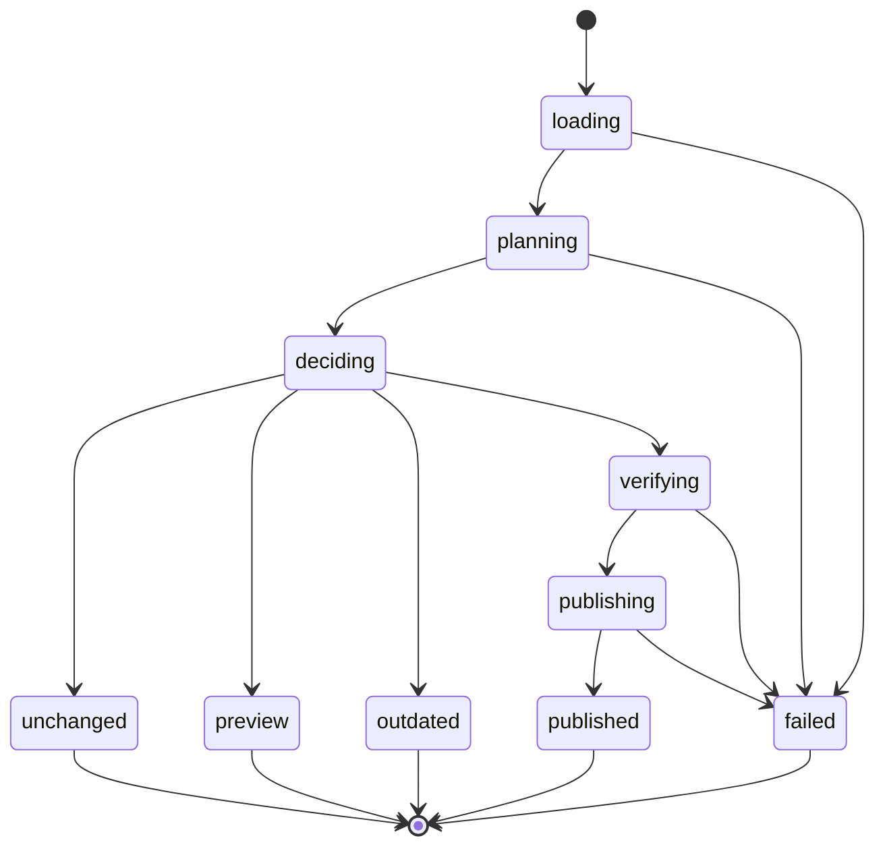

# Changesets

This repo uses [Changesets](https://github.com/changesets/changesets) to version packages and write changelogs.

## Dependabot updates

The Dependabot changesets workflow generates patch changesets for changes to public package `dependencies`.
It skips private packages, packages matched by `ignore` patterns, development dependencies, GitHub Actions, and lockfile-only updates.
It stops for peer dependency changes, dependency additions or removals, and package identity changes. Review those changes manually.

The workflow reads manifests at the PR merge base and head commits. It reads configuration from `main`.
It supports this repo's `packages/*` workspace layout. Other layouts fail validation.
It reserves `.changeset/dependabot-<PR number>.md` for generated content. Do not edit that file manually.
Each run updates that file or removes it when no runtime updates remain. Other changesets stay unchanged.

The workflow runs TypeScript from `main`. It reads PR files through the GitHub API and does not execute PR code.
It verifies that the PR is still open and its head has not changed before publishing.
It uses GitHub's `createCommitOnBranch` mutation with `expectedHeadOid`.
GitHub accepts the commit only if the branch still points to the captured head. This also rejects concurrent branch rewinds.
Failed writes are not retried. Rerun the workflow to read the current PR state.

The XState machine follows this sequence:



### Configure the GitHub App

Install a GitHub App on this repository. Grant it **Contents: read and write** and **Pull requests: read**.
Set the Actions variable `DEPENDENCY_CHANGESETS_APP_ID` to its App ID.
Set the Actions secret `DEPENDENCY_CHANGESETS_APP_PRIVATE_KEY` to its private key.
The workflow creates a token only when it needs to commit. The App token lets the commit trigger normal PR checks.

Auto-merge runs after changeset generation. It keeps the existing Dependabot metadata verification and merge policy.
Missing App credentials block runtime updates that need a changeset. Updates that do not need a changeset can proceed.
The required QA job checks the generated file in read-only mode. Missing or stale content fails QA even if auto-merge is already enabled.
Keep `qa` required and require branches to be up to date. Update existing PR branches after deploying this workflow.

### Process an existing PR

Merge the workflow and script into `main` first. Then run a preview:

```bash
gh workflow run dependabot-changesets.yml -f pr-number=40 -f preview=true
```

Check the generated plan in the workflow log. To commit the changeset:

```bash
gh workflow run dependabot-changesets.yml -f pr-number=40 -f preview=false
```

Manual preview runs do not change the PR.
A manual publication creates an App commit. That commit starts the automatic workflow, which can enable auto-merge for npm patch or security updates.

To preview locally, set `GH_TOKEN` to a token with repository read access:

```bash
GITHUB_REPOSITORY=nicklemmon/utils PR_NUMBER=40 CHANGESET_MODE=preview \
  npm run --silent generate --workspace=@repo/dependency-changesets
```

Preview is the default. Set `CHANGESET_MODE=publish` to publish with a token that has Contents write access.
Set `CHANGESET_MODE=check` to exit with code 1 if the generated file needs an update. Check mode never writes.
In CI, set `CHANGESET_EXPECTED_HEAD` to the event's PR head SHA. A newer head rejects the stale workflow run.

## Manual changesets

```bash
npm run changesets:add
```

After changesets land on `main`, the Release workflow opens a Version Packages PR. Merging that PR bumps versions, updates changelogs, and publishes public packages to npm with Trusted Publishing (OIDC).

For a local version bump without publishing:

```bash
npm run changesets:version
```

For a local publish (bootstrap or debug only; prefer CI after Trusted Publishing is configured):

```bash
npm run changesets:publish
```
